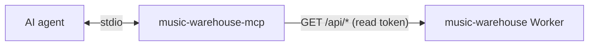

<div align="center">
<h1>music-warehouse-mcp</h1>
<p><strong>Ask your AI agent about years of your own Spotify listening.</strong></p>
<p>
<a href="LICENSE"></a>

<a href="https://modelcontextprotocol.io"></a>
<a href="https://github.com/rcnsh/music-warehouse#clients"></a>
</p>
<p><a href="#quick-start">Quick start</a> · <a href="#setup">Setup</a> · <a href="#configuration">Configuration</a> · <a href="#tools">Tools</a> · <a href="#development">Development</a></p>
</div>

An [MCP](https://modelcontextprotocol.io) server that lets an AI agent (Claude
Code, Claude Desktop, Cursor and others) query the Spotify listening history
stored by a [music-warehouse](https://github.com/rcnsh/music-warehouse) Worker.
The agent answers from your own data, years of it, not Spotify's last 50 plays.
It runs locally over stdio and only reads.

> [!NOTE]
> This needs your own music-warehouse deployment. If you don't have one yet,
> start with the warehouse's
> [quick start](https://github.com/rcnsh/music-warehouse#quick-start).

## What it does

Ask things like:

- "What was I into in spring 2022?"
- "When did I first play Shelter?"
- "How has my listening changed since I moved?"

and the agent picks the right [tools](#tools): fifteen of them, all read-only,
covering search, plays, top artists and songs over any range, per-artist and
per-song history, precomputed stats, Wrapped-style summaries, upcoming
concerts, and what's playing now.

Responses are trimmed for an agent: no image URLs or Spotify API links, play
times shown in the local zone, Spotify objects cut to name, artists, album and
id.

## How it works



Every tool calls the Worker's `/api/*` routes with a read-only token. The
Worker does the storage and aggregation; this server only shapes the answers.

### Why stdio, not a remote server

Running locally keeps the token on your machine and needs no change to the
Worker beyond the read routes. The trade-off is that claude.ai on the web and
mobile can't use it: their custom connectors need a remote server with OAuth.

## Requirements

- A deployed music-warehouse Worker at a version that has `/api/search` and
  `/api/top-tracks` (October 2026 or later), and `/api/concerts` for
  `upcoming_concerts`. To sign in with Spotify instead of copying a token, it
  also needs
  [Spotify sign-in](https://github.com/rcnsh/music-warehouse#signing-in-with-spotify).
- Node.js 20 or later.

It isn't published to npm; install it from source as below.

## Quick start

```bash
git clone https://github.com/rcnsh/music-warehouse-mcp && cd music-warehouse-mcp
npm install
npm run login -- --url https://music-warehouse.<you>.workers.dev
claude mcp add --scope user music-warehouse \
  -e MUSIC_WAREHOUSE_URL=https://music-warehouse.<you>.workers.dev \
  -- node "$PWD/dist/index.js"
```

Then `/mcp` in Claude Code shows it connected. Each step is explained below.

## Setup

### 1. Build

```bash
git clone https://github.com/rcnsh/music-warehouse-mcp && cd music-warehouse-mcp
npm install          # also builds dist/
```

### 2. Get a read token

**Sign in with Spotify** (easiest). Use the Spotify account that owns the
warehouse:

```bash
npm run login -- --url https://music-warehouse.<you>.workers.dev
```

It opens your browser (and prints the URL in case it doesn't), and once you
approve, saves a read token for that warehouse to
`~/.config/music-warehouse-mcp/tokens.json` (`$XDG_CONFIG_HOME` if set),
readable only by you. The token is listed on the warehouse as
`MCP (<hostname>)` (see the warehouse's
[device tokens](https://github.com/rcnsh/music-warehouse#device-tokens)); pass
`--name` to choose another. It expires after 90 days: the tools then say so,
and you run the same command again. The server reads the file on every call,
so a new sign-in needs no restart.

`--url` defaults to `MUSIC_WAREHOUSE_URL`. If you install the clone globally
(`npm install -g .`), the same command is
`music-warehouse-mcp login --url …`.

**Or store a token yourself.** On macOS, put the Worker's `READ_TOKEN` in the
Keychain, under the service `music-warehouse-mcp` and your Worker's host as the
account. `security` prompts for it, so it never lands in your shell history:

```bash
security add-generic-password -s music-warehouse-mcp -a music-warehouse.<you>.workers.dev -w
```

Elsewhere, set `MUSIC_WAREHOUSE_TOKEN` in the MCP client's config instead (see
[Configuration](#configuration)). Either one wins over a signed-in token.

> [!IMPORTANT]
> Use a read token, never `ADMIN_TOKEN`: nothing here needs more.

### 3. Add it to your client

<details open>
<summary><strong>Claude Code</strong></summary>

For every project:

```bash
claude mcp add --scope user music-warehouse \
  -e MUSIC_WAREHOUSE_URL=https://music-warehouse.<you>.workers.dev \
  -- node "$PWD/dist/index.js"
```

Run it from the clone, so `$PWD` is the right path. Then `/mcp` in Claude Code
shows it connected. If you run more than one Claude Code config directory
(`CLAUDE_CONFIG_DIR`), run the command once under each.

</details>

<details>
<summary><strong>Claude Desktop, Cursor and others</strong></summary>

They take the same thing as JSON, in their MCP server config:

```json
{
  "mcpServers": {
    "music-warehouse": {
      "command": "node",
      "args": ["/absolute/path/to/music-warehouse-mcp/dist/index.js"],
      "env": { "MUSIC_WAREHOUSE_URL": "https://music-warehouse.<you>.workers.dev" }
    }
  }
}
```

</details>

> [!TIP]
> A GUI app may not see your shell's `PATH`; if it can't start `node`, give its
> absolute path (`which node`).

### 4. Check it

```bash
MUSIC_WAREHOUSE_URL=https://music-warehouse.<you>.workers.dev npm run smoke
```

calls every tool once against your Worker and prints the start of each
answer. Or explore interactively with `npm run inspect`.

## Configuration

| Variable | Required | Meaning |
|---|---|---|
| `MUSIC_WAREHOUSE_URL` | yes | The Worker's origin. Must be `https`, except on loopback (`http://127.0.0.1:8787` for `wrangler dev`). |
| `MUSIC_WAREHOUSE_TOKEN` | no | A read token, overriding the Keychain and a signed-in token. |
| `MUSIC_WAREHOUSE_TZ` | no | IANA zone for local dates and times. Defaults to the system's. |
| `XDG_CONFIG_HOME` | no | Where `login` saves tokens, under `music-warehouse-mcp/`. Defaults to `~/.config`. |

The token is the first of:

1. `MUSIC_WAREHOUSE_TOKEN`.
2. The macOS Keychain entry for the Worker's host (service `music-warehouse-mcp`).
3. The token `npm run login` saved for the Worker's origin. Tokens are saved
   per origin, so one is only ever sent to the warehouse that minted it.

A missing or expired token doesn't stop the server starting: each tool says how
to provide one, and the next call picks it up without a restart. A rejected
token (401) names the login command.

## Tools

Fifteen tools, all read-only. Dates are `YYYY-MM-DD` local days in the
configured zone.

| Tool | Answers | Worker route |
|---|---|---|
| `search` | Artists and songs by name, with all-time plays. The way in to the history tools. | `/api/search` |
| `get_plays` | Individual plays, newest first, in a window. Pages with `next_before`. | `/api/plays` |
| `top_artists` | Plays per artist between two dates. | `/api/top-artists` |
| `top_tracks` | Plays per song between two dates, editions folded. | `/api/top-tracks` |
| `upcoming_concerts` | Ticketmaster gigs in the regions your warehouse watches, for your top artists; `since` for what's new. | `/api/concerts` |
| `daily_play_counts` | Plays per day, or summed per week or month, with a total. | `/api/daily` |
| `artist_history` | One artist's plays, minutes, first and last play, months, top songs. | `/api/artist` |
| `track_history` | The same for one song, editions folded together. | `/api/track` |
| `on_this_day` | Top songs on this date in each earlier year. | `/api/on-this-day` |
| `get_stat` | `on-repeat`, `rhythm`, `top-over-time`, `eras` or `albums`. | `/api/stats/{name}` |
| `list_wrapped_ranges` | Which ranges `get_wrapped` can summarise. | `/api/wrapped/ranges` |
| `get_wrapped` | A Wrapped-style summary of a finished range. | `/api/wrapped` |
| `now_playing` | What's playing right now. | `/api/now-playing` |
| `recently_played_live` | Spotify's last plays, including ones not stored yet. | `/api/recently-played` |
| `spotify_top` | Spotify's own top tracks and artists. | `/api/top` |

> [!NOTE]
> The last three are live and need the Worker's Spotify grant; the rest read
> stored rows and keep working when it lapses.

When a tool fails, its message says why and what to do: a rejected token names
`npm run login`, a lapsed grant names `npm run authorize` in the
music-warehouse repo, a stat still computing is waited out (up to 25 s) before
giving up.

## Development

| Command | Does |
|---|---|
| `npm run build` | `tsc` → `dist/` |
| `npm test` | vitest: the client, formatting, sign-in, and every tool over an in-memory MCP connection |
| `npm run typecheck` | Type-checks source and tests |
| `npm run smoke` | Calls every tool once against a real Worker (needs `MUSIC_WAREHOUSE_URL`) |
| `npm run inspect` | Opens the MCP Inspector on `dist/index.js` |

Tests fake `fetch`, so they need no Worker. The sign-in test runs the real
loopback listener and plays the browser's redirect itself. `npm run smoke` is
the end-to-end check against a real one.

## Related projects

| Project | |
|---|---|
| [music-warehouse](https://github.com/rcnsh/music-warehouse) | The Worker: records your plays and serves the API |
| [music-warehouse-gui](https://github.com/rcnsh/music-warehouse-gui) | Native macOS app for browsing your history |
| [music-warehouse-mcp](https://github.com/rcnsh/music-warehouse-mcp) (this repo) | MCP server so AI agents can query your history |
| [music-warehouse-spicetify](https://github.com/rcnsh/music-warehouse-spicetify) | Stats inside the Spotify desktop client |
| [music-warehouse-wrapped](https://github.com/rcnsh/music-warehouse-wrapped) | Wrapped-style stories for any range, in the browser |

## Licence

MIT. See [LICENSE](LICENSE).
